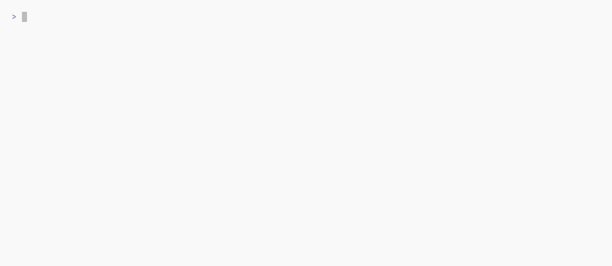

# actionlint

[![CI Status][ci-badge]][ci]
[![Latest release][release-badge]][releases]
[![NPM Version][npm-badge]][npm-package]
[![pkg.pr.new][preview-badge]][previews]
[![Docker image version][docker-badge]][dockerhub]
[![Sponsor this project][sponsor-badge]][sponsor]

[actionlint][repo] is a static checker for GitHub Actions workflow files. [Try it online!][playground]

This is an actively maintained fork of [rhysd/actionlint][upstream]. It adds cache safety checks enabled by default, opt-in [policy checks][config], composite action step validation, shell completion and a GitHub Action. Releases include attested binaries and Docker images on [GHCR][ghcr] and [Docker Hub][dockerhub]. Report problems through [this fork's issue tracker][issue-form].

## Fork provenance and versioning

This fork builds on upstream [v1.7.12](https://github.com/rhysd/actionlint/releases/tag/v1.7.12), at [`rhysd/actionlint@914e7df`]. Its independent release series starts at v1.8.0. Tags published by `kjanat/actionlint` identify this fork's releases. Upstream may not have a matching tag.

The [changelog] lists fork releases separately from upstream history. Releases follow [Semantic Versioning for the supported CLI and configuration]. The [CLI compatibility] policy covers existing integrations. New or corrected checks can report problems in workflows that previously passed CI. Other programs connect through the [integration interfaces].

## Features

- Report unexpected or missing keys according to GitHub's [workflow syntax][syntax-doc].
- Check types in `${{ }}` expressions, including references to nonexistent properties.
- Check action inputs at `with:` and outputs at `steps.{id}.outputs`.
- Check inputs, outputs and secrets passed to reusable workflows.
- Run [shellcheck] on shell scripts in `run:` steps.
- Run [Ruff](docs/config.md#ruff) on Python `run:` scripts without a Python interpreter.
- Report [script injection][script-injection-doc] through untrusted values and hard-coded credentials.
- Check [glob syntax][filter-pattern-doc], `needs:` dependencies, runner labels and cron syntax.

See the [full list of checks][checks].

<picture>
  <source
    media="(prefers-color-scheme: dark)"
    srcset="docs/screenshots/actionlint-dark.gif"
  >
  <source
    media="(prefers-color-scheme: light)"
    srcset="docs/screenshots/actionlint-light.gif"
  >
  
</picture>

<details><summary><h3>Example of a broken workflow</h3></summary>

The animation and the comparison below use the same files. [`tools/docs/readme-demo.mjs`] generates this section by running both linters on those files.

<!-- BEGIN generated demo -->

`docs/screenshots/demo-workflow.yaml`:

```yaml
name: Release
on:
  push:
    branches: [main]
jobs:
  build:
    strategy:
      matrix:
        node: ["20", "22"]
    runs-on: ubuntu-26.04
    timeout-minutes: ${{ matrix.node }}
    steps:
      - uses: actions/checkout@v7
      - run: npm run mock-api
        id: mock
        background: true
      - run: npm test
      - wait: api
```

`docs/screenshots/actionlint.yaml`:

```yaml
# yaml-language-server: $schema=https://cdn.jsdelivr.net/gh/kjanat/actionlint@1/actionlint.schema.json
---
policy:
  require-commit-hash: true
```

**Upstream actionlint 1.7.12 reports 3: `runner-label`, `syntax-check` ×2**

```console
demo-workflow.yaml:10:14: label "ubuntu-26.04" is unknown. available labels are "windows-latest", "windows-latest-8-cores", "windows-2025", "windows-2025-vs2026", "windows-2022", "windows-11-arm", "ubuntu-slim", "ubuntu-latest", "ubuntu-latest-4-cores", "ubuntu-latest-8-cores", "ubuntu-latest-16-cores", "ubuntu-24.04", "ubuntu-24.04-arm", "ubuntu-22.04", "ubuntu-22.04-arm", "macos-latest", "macos-latest-xlarge", "macos-latest-large", "macos-26-intel", "macos-26-xlarge", "macos-26-large", "macos-26", "macos-15-intel", "macos-15-xlarge", "macos-15-large", "macos-15", "macos-14-xlarge", "macos-14-large", "macos-14", "self-hosted", "x64", "arm", "arm64", "linux", "macos", "windows". if it is a custom label for self-hosted runner, set list of labels in actionlint.yaml config file [runner-label]
   |
10 |     runs-on: ubuntu-26.04
   |              ^~~~~~~~~~~~
demo-workflow.yaml:16:9: unexpected key "background" for step to run shell command. expected one of "continue-on-error", "env", "id", "if", "name", "run", "shell", "timeout-minutes", "working-directory" [syntax-check]
   |
16 |         background: true
   |         ^~~~~~~~~~~
demo-workflow.yaml:18:9: step must run script with "run" section or run action with "uses" section [syntax-check]
   |
18 |       - wait: api
   |         ^~~~~
```

**This fork 1.17.0 reports 3: `expression`, `require-commit-hash`, `parallel-steps`**

```console
demo-workflow.yaml:11:22: type of expression at "float number value" must be number but found type string [expression]
   |
11 |     timeout-minutes: ${{ matrix.node }}
   |                      ^~~
demo-workflow.yaml:13:15: the ref "v7" of action "actions/checkout@v7" is not a commit SHA. actions must be pinned to a full-length commit SHA (40 or 64 hexadecimal digits) because "require-commit-hash" is enabled in the "policy" configuration. see https://docs.github.com/en/actions/security-for-github-actions/security-guides/security-hardening-for-github-actions#using-third-party-actions for more details [require-commit-hash]
   |
13 |       - uses: actions/checkout@v7
   |               ^~~~~~~~~~~~~~~~~~~
demo-workflow.yaml:18:15: "api" is not the ID of a preceding background step. "wait" and "cancel" steps can only refer to an earlier step that has "background: true" [parallel-steps]
   |
18 |       - wait: api
   |               ^~~
```

<!-- END generated demo -->

</details>

## Quick start

Install with [npm], [Homebrew], [AUR],
[Scoop], [WinGet], or [mise], or download [a release archive][releases].
See [installation][install] for all options. To run it through npm:

```sh
npx @kjanat/actionlint
```

With a Go toolchain, install it from source:

```sh
go install actionlint.kjanat.dev/v2/cmd/actionlint@latest
```

<sub><em><code>actionlint.kjanat.dev/v2</code> is a <a href="https://pkg.go.dev/cmd/go#hdr-Fully_qualified_import_paths" title="Fully-qualified import paths">Go vanity import path</a>. The Go toolchain resolves it to <a href="https://github.com/kjanat/actionlint" title="https://github.com/kjanat/actionlint">this GitHub repository</a>, where the source, releases, and issue tracker live. Further reading available here: <a href="https://go.dev/ref/mod#goproxy-protocol" title="GOPROXY protocol">GOPROXY protocol</a>. Check for yourself: </em><code>curl https://proxy.golang.org/actionlint.kjanat.dev/v2/@latest</code></sub>

Run `actionlint check` in your repository to find and check workflows and action manifests. Running `actionlint` without arguments also checks the current Git repository. Outside a repository, it displays help and exits 0. `actionlint check` exits 3 when it finds no files to analyze.

```sh
actionlint check
```

Try actionlint in your browser with [the online playground][playground], which runs it through WebAssembly.

See [usage][usage] for command options and examples.

## GitHub Action

This example runs the `v1` actionlint GitHub Action with GitHub annotations:

```yaml
name: Lint workflows
on: [push, pull_request]
permissions: { contents: read }
jobs:
  lint:
    runs-on: ubuntu-latest
    steps:
      - uses: actions/checkout@v7
        with: { persist-credentials: false }
      - uses: kjanat/actionlint@v1
```

For v1, use the `config-file` input to select a configuration file.

### v2 configuration

Put project settings for the v2 Action in [`.github/actionlint.yaml`](docs/config.md).
Use the `config` input to override settings for one run. You can omit the `with:` block when using the defaults.

The v2 actionlint GitHub Action runs on Linux, macOS and Windows without Docker.
Use a published release commit SHA or `vX.Y.Z` tag to select an exact release. The `v1` and `v1.X` tags move to newer releases.

See the [Action guide](docs/action.md) for configuration, saved reports,
optional PR reviews, tool prerequisites, migration and the input/output reference.

## pre-commit

For v2, hooks move to [kjanat/actionlint-pre-commit](https://github.com/kjanat/actionlint-pre-commit).
The first v2 hook release is pending. Once published, use its exact tag in
`.pre-commit-config.yaml`:

```yaml
repos:
  - repo: https://github.com/kjanat/actionlint-pre-commit
    rev: <published-v2-tag>
    hooks: [id: actionlint]
```

The default hook installs actionlint from the matching Python wheel in an isolated environment.
The project's plugin declarations select exact versions of the ShellCheck and Ruff Wasm plugins.
See [v2 migration](docs/migration-v2.md) for existing hook configurations.

## Documents

- [AI usage and policy] and [CLI compatibility]: How this fork uses AI and supports existing workflows and CI integrations.
- [Checks]: Checks with examples, expected diagnostics and playground links.
- [Installation][install]: Install with npm, Homebrew, AUR, Scoop, WinGet, aqua, mise, the community pip/uv wrapper, release archives, the download script, Docker, or Go. Includes upstream-only package names.
- [Usage]: Run actionlint locally, in GitHub Actions, in the playground or in Docker. Includes integrations with reviewdog, Problem Matchers, super-linter, pre-commit and VS Code.
- [Configuration][config]: Runner labels, variables, secrets, default permissions, error filters, and opt-in policy checks, with YAML Language Server schema support.
- [Integration interfaces][api]: Use the CLI, language server and plugin SDKs from other programs.
- [Schema audit]: Pinned upstream definitions, compatibility fixes, validation results and intentional differences.
- [Expression behavior]: Reproduce GitHub's runtime behavior, understand parser differences, and avoid surprising workflow decisions.
- [References][refs]: Links to resources.
- [GitHub Actions changelog][github-changelog]: Browse and search the latest entries from GitHub's Actions changelog feed.

## Bug reporting

To report a bug or false positive, [file an issue][issue-form] with a minimal example. You can also request features or suggest checks.

See the [contribution guide] for more details.

## License

actionlint's code is distributed under [the MIT license].
Its [branding artwork](docs/assets/brand/README.md) is separately licensed under [CC BY 4.0](docs/assets/brand/LICENSE.md).

[AI usage and policy]: CONTRIBUTING.md#ai-usage-and-policy
[AUR]: docs/install.md#arch-linux
[CLI compatibility]: CONTRIBUTING.md#cli-compatibility
[Expression behavior]: docs/expression-behavior.md
[integration interfaces]: docs/api.md
[Homebrew]: docs/install.md#homebrew
[Schema audit]: docs/schema-audit.md
[Scoop]: docs/install.md#scoop
[WinGet]: docs/install.md#winget
[Semantic Versioning for the supported CLI and configuration]: CONTRIBUTING.md#release-versioning
[`tools/docs/readme-demo.mjs`]: tools/docs/readme-demo.mjs
[changelog]: CHANGELOG.md#upstream-history
[ci-badge]: https://github.com/kjanat/actionlint/actions/workflows/ci.yml/badge.svg
[ci]: https://github.com/kjanat/actionlint/actions/workflows/ci.yml
[config]: docs/config.md
[contribution guide]: ./CONTRIBUTING.md
[docker-badge]: https://img.shields.io/docker/v/kjanat/actionlint?logo=docker&logoColor=white&label=Docker&labelColor=2496ED&color=black
[dockerhub]: https://hub.docker.com/r/kjanat/actionlint
[filter-pattern-doc]: https://docs.github.com/actions/using-workflows/workflow-syntax-for-github-actions#filter-pattern-cheat-sheet
[ghcr]: https://github.com/kjanat/actionlint/pkgs/container/actionlint
[github-changelog]: https://actionlint.kjanat.dev/github-changelog/
[issue-form]: https://github.com/kjanat/actionlint/issues/new
[mise]: docs/install.md#mise
[npm]: docs/install.md#npm
[npm-badge]: https://img.shields.io/npm/v/@kjanat/actionlint?logo=npm&labelColor=CB3837&color=black
[npm-package]: https://npm.im/@kjanat/actionlint
[playground]: https://kjanat.github.io/actionlint/
[preview-badge]: https://pkg.pr.new/badge/kjanat/actionlint
[previews]: https://pkg.pr.new/~/kjanat/actionlint
[release-badge]: https://img.shields.io/github/v/release/kjanat/actionlint?logo=github&logoColor=white&label=release&labelColor=181717&color=black
[releases]: https://github.com/kjanat/actionlint/releases
[repo]: https://github.com/kjanat/actionlint
[script-injection-doc]: https://docs.github.com/actions/reference/security/secure-use#good-practices-for-mitigating-script-injection-attacks
[shellcheck]: https://github.com/koalaman/shellcheck
[sponsor-badge]: https://img.shields.io/badge/Sponsor-ea4aaa?logo=githubsponsors&logoColor=white
[sponsor]: https://github.com/sponsors/kjanat
[syntax-doc]: https://docs.github.com/actions/reference/workflow-syntax-for-github-actions
[the MIT license]: ./LICENSE.txt
[upstream]: https://github.com/rhysd/actionlint

<!-- documentation in this checkout -->

[api]: docs/api.md
[checks]: docs/checks.md
[install]: docs/install.md
[refs]: docs/reference.md
[usage]: docs/usage.md

<!-- specific commit refs -->

[`rhysd/actionlint@914e7df`]: https://github.com/rhysd/actionlint/commit/914e7df21a07ef503a81201c76d2b11c789d3fca
