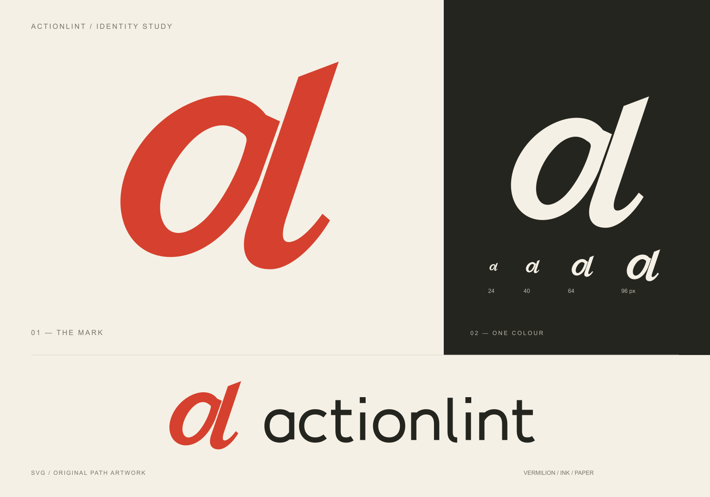

# actionlint identity

Copyright (c) 2026 Kaj Kowalski. The artwork and previews are licensed under
[CC BY 4.0](https://creativecommons.org/licenses/by/4.0/); see [the branding licence](LICENSE.md).
Each SVG embeds RDF/Dublin Core metadata with attribution, creation date, source,
and a copyright notice with a link to the CC licence, so these details travel with the file.

When sharing the artwork, credit Kaj Kowalski, link to the original work and licence,
and identify any changes. Do not present the original artwork as your own or imply
endorsement. For example:

> actionlint identity © 2026 [Kaj Kowalski](https://github.com/kjanat).
> [Original work](https://github.com/kjanat/actionlint),
> [CC BY 4.0](https://creativecommons.org/licenses/by/4.0/). Unmodified.

The symbol is a custom, forward-leaning `al` monogram. Its broad curves and cut
terminals borrow from lettering and printed editorial marks. A narrow diagonal
of negative space separates the bowl from the ascending stroke. The wordmark is
drawn separately, with quieter upright letters to balance the symbol.

- [actionlint.svg](actionlint.svg) is the horizontal logo for light backgrounds.
- [actionlint-dark.svg](actionlint-dark.svg) is the horizontal logo for dark backgrounds.
- [actionlint-mark.svg](actionlint-mark.svg) is the standalone symbol, suitable for avatars.
- [actionlint-avatar.png](actionlint-avatar.png) is a 512-pixel square export on warm paper for services that require PNG.
- [preview.svg](preview.svg) is the editable presentation; [preview.png](preview.png) is its rendered preview.
  It shows the identity on light and dark backgrounds and at small sizes.

The three logo SVGs have transparent backgrounds and contain only vector geometry.
They do not load fonts, scripts, images, or external resources. The lettering is
original path artwork, not live text.

The colours are vermilion `#D5412E`, ink `#25251F`, and warm paper `#F5F0E6`.
The dark version uses a lighter vermilion, `#F07860`, and paper-coloured lettering.
For a single-colour application, give every path the same colour. The symbol does
not depend on colour to preserve its shape.

Leave at least one eighth of the symbol's width clear around it. Use the symbol
alone below a horizontal logo width of 240 pixels; its smallest intended size is
24 pixels. Keep the artwork's proportions intact.
