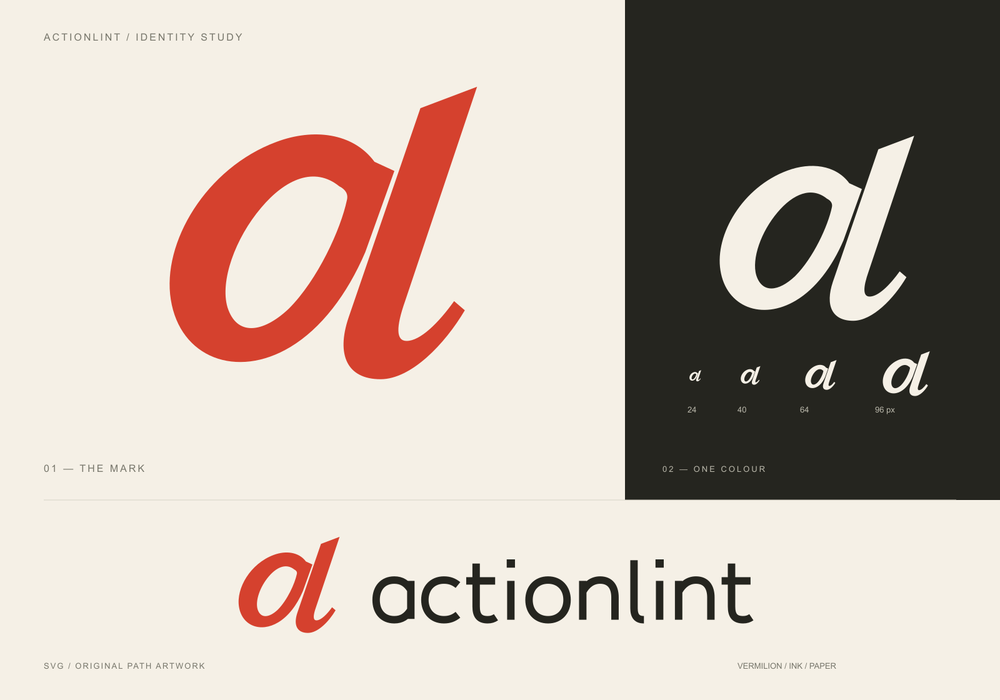

# actionlint identity

Copyright (c) 2026 Kaj Kowalski. The artwork and previews are licensed under [CC BY 4.0](https://creativecommons.org/licenses/by/4.0/). See [the branding licence](LICENSE.md).

Credit the artwork and state any changes, for example:

> actionlint identity © 2026 [Kaj Kowalski](https://github.com/kjanat).
> [Original work](https://github.com/kjanat/actionlint),
> [CC BY 4.0](https://creativecommons.org/licenses/by/4.0/). Unmodified.

- [actionlint.svg](actionlint.svg) is the horizontal logo for light backgrounds.
- [actionlint-dark.svg](actionlint-dark.svg) is the horizontal logo for dark backgrounds.
- [actionlint-mark.svg](actionlint-mark.svg) is the symbol alone.
- [actionlint-avatar.png](actionlint-avatar.png) is a 512-pixel square PNG avatar.

The colours are vermilion `#D5412E`, ink `#25251F` and warm paper `#F5F0E6`. The dark logo uses vermilion `#F07860` with paper-coloured lettering.

Leave one eighth of the symbol's width clear around it. Below a logo width of 240 pixels, use the symbol alone. Keep the symbol at least 24 pixels wide.
