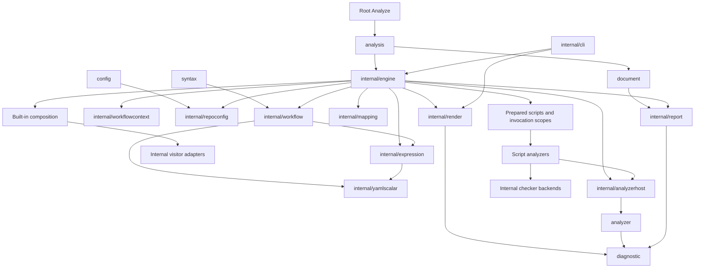
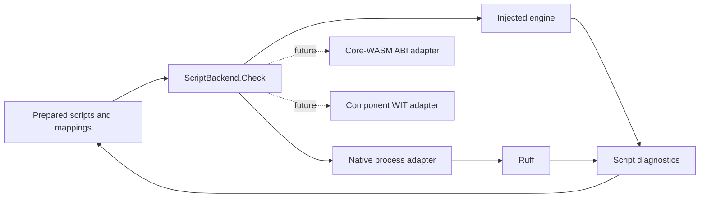

# Analysis contracts and library boundaries

Status: implemented, with the internal visitor migration boundary described below.

## Context

The old root package exposed the same objects used to run the CLI: mutable visitor rules, error collectors,
configuration setters, process scheduling and caches. Traversal failure could skip the post-visit hook that drained
external checkers. The host consequently needed concrete ShellCheck and Ruff type checks to finish work. Composite
analysis repeated tool-specific construction and context handling.

Moving those objects into directories does not provide an independent analyzer contract. The library needs explicit
inputs and returned results, while the host must own completion even when traversal fails.

## Decision

Keep one module and separate the public packages by responsibility. Root contains the convenience entry point and
generation directives. The analysis host and remaining visitor rules live in `internal/engine`.
`internal/workflow` owns workflow syntax, parsing and scalar source maps. `internal/expression` owns expression
parsing, types, constant evaluation and semantic checks. Both implementations can run without the analysis host.
`internal/repoconfig` owns the configuration document, its validation and the built-in rule catalog; the engine
attaches execution behaviour to catalog entries by name. `internal/render` presents results as text, Go templates,
JSON, SARIF and GitHub annotations from diagnostics, source text and rule metadata.
`internal/analyzerhost` owns generic execution and resource scopes. `internal/report` owns document models and their codecs; the public `document` package exposes those models without
importing the engine. Existing focused internal packages retain ownership
of mapping resolution, external checker logic, filesystem reads, configuration trees and suppressions.

New analyzers declare required facts and return diagnostics and errors. They have no AST-visit, configuration mutation
or debug-output methods. The host isolates their input slices, validates fact availability, preserves partial results,
and joins execution before returning. Cancellation is cooperative: implementations must honor their context and finish
child work before returning. Registration order determines combination order, followed by normal source ordering.

A document resource scope registers join operations before execution. It drains every resource after traversal and on
early exit, including injected checkers with their own runners. Concurrent completion calls share one result. Resource
ownership is a separate capability from internal traversal rules. Configuration and debug configuration are separate
capabilities too. The document runner does not identify external tool types to wait for them.

Tool selection and initialization policy belong to built-in composition. Ruff, ShellCheck and deprecated-command checks
consume a prepared script batch and return findings and an error. They do not implement visitors. Each invocation records
its shell selection, configuration, source location and suppression origin. ShellCheck additionally requires effective
execution facts: runner defaults, working directories and checkout/action placement. The collector resolves these facts
only when a selected analyzer requires them. Composite scripts receive their own scope and do not inherit workflow shell
or working-directory defaults.

Built-in script analyzers and public analyzers use the same bounded task executor. It preserves registration order and
partial results and waits for every started task. Each external checker owns and joins its callbacks before returning,
including on cancellation or an error. Callbacks write to separate per-script result slots. Rendering retains rule
metadata. The Playground supplies an embedded ShellCheck runner directly.

Composite analysis still requests capabilities for the remaining visitor adapters: checkout state, metadata validation,
child construction and result joining. Configuration for action inputs is projected to applicable rules before overrides
are merged. Workflow-only option constraints cannot invalidate an action's script or suppression settings. Tool planning
and analysis use the same selected-input scope.

Mapping resolution provides one key contract: canonical value, source provenance, evaluated-data provenance and
known/unknown/invalid state. Runtime names keep their object shapes open. Consumers must preserve that uncertainty
and treat expression-looking text returned as data as a literal value.

## Tradeoffs and limits

- One module makes these packages share a release and permits internal implementation imports. Separate modules would
  require independent compatibility and release contracts that this change does not establish.
- Configuration and syntax alias independent implementations. Importing either public package no longer imports
  discovery, rule execution or native tools. The parser retains
  decoded source maps alongside syntax because accurate diagnostics require both.
- Remaining engine work includes discovery, action metadata and visitor rules.
  These extractions remove two language subsystems; they do not make the engine a composition-only package yet.
- Existing built-in checks still use a shared AST traversal internally. This change removes that traversal from the public
  extension contract and separates its resource/configuration/debug capabilities; it does not claim that every built-in
  rule has been rewritten as a fact consumer.
- Script facts describe declarations. They do not promise complete effective runtime environments or resolved default
  shells. Mapping completeness describes static knowledge.
- Existing CLI behavior remains covered by its own tests. Removed library symbols have explicit migration guidance;
  there is no root compatibility layer re-exporting the old implementation.

## Verification

External-package tests exercise the public root entry point, config and syntax packages, file analysis, custom analyzer
partial results and composite-action scripts. Host tests cover input isolation, unavailable facts, cancellation and
joining all resources once. Engine regressions cover traversal failure, cancellation with retained findings, independent script scopes and fallback
when either ShellCheck range endpoint cannot be mapped. Import-boundary tests check that the public analyzer, diagnostic,
document, syntax and config contracts, together with the standalone language, configuration and rendering implementations,
have no transitive dependency on the engine, CLI or process execution. A separate guard prevents expression semantics from importing
workflow ASTs, analyzer execution or repository configuration trees. Existing semantic, CLI,
generator and conformance suites remain applicable.

## Decision: separate engines from execution transports

Script engines now have a synchronous request/result contract in `analyzer`: sanitized source, virtual
filename and engine-owned configuration in; diagnostics and an optional error out. `analysis.Tool`
selects a backend implementation or the native process adapter, with ambiguous selections rejected.
Command lines, environment variables, executable discovery and stdout decoding remain transport details.
The native Ruff adapter and injected backends use the same host scheduling and source-mapping path.

The existing actionlint-plugin-ruff `check` operation is the reference for Ruff's payload and coordinates.
The host does not duplicate Ruff's full options catalogue. The native adapter converts native options into
isolated, read-only invocation settings. Integration-controlled file access and output options are rejected.
Existing CLI Pyflakes compatibility remains an adapter concern; it does not define the backend interface.

ShellCheck can use the same backend contract for hermetic snippets. Its native path still has additional
source-file and fix capabilities. Those are not silently promised to injected engines: external-source
and rc-file requests fail until an explicit resource capability exists. Extending that contract needs source
identity, content, dependencies and edit provenance.

Backend completion is synchronous and diagnostics can accompany failure. The host bounds concurrent work,
waits for every started operation, and rejects diagnostics that refer to a different virtual input. Caller-owned
backends can be reused across documents; an adapter must serialize or pool instances when its runtime is not
concurrent. A future WASM adapter must handle memory limits, cancellation, traps and instance disposal itself.
The host does not inspect backend concrete types for cleanup.

The Go interface is not the plugin wire ABI. Core module memory ownership and ABI version negotiation stay
in the core-WASM adapter. Component-WASM uses a separate WIT binding and resource lifecycle. Neither Go
pointers nor Rust layout/traits cross that boundary. A Rust host can implement the same operation semantics
without reproducing Go's package structure. This change does not add a WASM loader or select a runtime.

An argv-only abstraction was rejected because it would force embedded engines to implement CLI parsing and
stdout protocols. A universal filesystem capability was deferred because the current Ruff plugin needs none
and ShellCheck requires explicit source/dependency semantics before such a capability can be specified.

## Decision: expose invocation context to analyzers

A document declares scripts; a workflow also invokes scripts that composite actions declare. The analyzer contract keeps
these apart: `Input.Scripts` holds the document's own run steps, `Input.Invoked` holds scripts reached through `uses:`
calls, each with its declaring path, the calling step, the reference text and the call depth. Both carry spans that map
script text to document positions, including decoded escapes and folded whitespace without a source, so an analyzer can
place a finding without parsing YAML. The `execution` fact adds the shell and working directory the runner would use,
with explicit known flags, and the host resolves it only when an analyzer asks.

The built-in deprecated-commands check consumes these facts through the same contract; the engine adapts its findings
to host state such as ignore origins and foreign sources. Public findings that name a composite action path are
filtered with that file's inline suppressions and configuration. Other built-in rules still run as visitors.

## Decision: run external analyzers as WebAssembly components

`plugins/wit/analyzer.wit` is the plugin contract. It mirrors the Go `analyzer` package: a `describe` call returns the
plugin name and required facts, and `analyze` receives one document with its declared and invoked scripts, spans,
invocation context, runtime facts, mappings and registered options, and returns diagnostics or an error message. The
host implements `kjanat:actionlint/host`, which currently carries one `log` function. Go host bindings for that import
are generated from the WIT with `wacogo-witgen`; guest bindings come from `wit-bindgen` in each plugin's language.
Exported calls use the runtime's reflective value API, so the host keeps one conversion layer per direction.

The runtime is `wacogo` on `wazero`: pure Go, no cgo, and a component-model implementation that covers the value
types this contract uses. `internal/component` loads a component, checks that it exports
`kjanat:actionlint/analyzer@0.1.0` and imports only the host interface and the granted `wasi:cli`, `wasi:io`,
`wasi:clocks`, `wasi:random` and `wasi:filesystem` interfaces, then calls `describe`. Every `analyze` call instantiates
the component anew under a per-call deadline and a memory limit, with an empty environment, no preopened directories
and stdio routed to the host log. Calls on one plugin are serialized. A trap, an exit through `wasi:cli/exit`, a
failed allocation, a deadline or a cancellation returns an error that names the plugin and its limits; the document's
analysis reports the failure with its partial findings. The engine and the public `analysis` package do not import the
runtime; the CLI loads plugins from `--plugin` and registers them as analyzers.

Verification uses a Rust example built with `wit-bindgen` for `wasm32-wasip2`, a C example built with `wit-bindgen c`
and wasi-sdk, a TinyGo example built with `wit-bindgen-go`, hand-written components that export the wrong interface
version, import a socket interface, import an unknown interface or export no analyzer, and a Rust test plugin that
traps, panics, exits, allocates past the limit, loops, reads a file, reads the environment and logs on request.
Architecture tests keep the engine free of the runtime and the loader free of the engine.

`wacogo` before https://github.com/partite-ai/wacogo/pull/12 rejected a null pointer from `cabi_realloc` for a
zero-size request, which the canonical ABI allows and TinyGo produces (https://github.com/partite-ai/wacogo/issues/11).
`go.mod` requires the merge commit of that pull request, which limits the trap to non-zero sizes.
`internal/component/runtime_limit_test.go` checks that an empty string lowers into a component whose realloc returns
null for size 0.

Core WebAssembly JSON engines such as `actionlint-plugin-ruff` keep their own transport behind
`analyzer.ScriptBackend`. `internal/corewasm` runs them on `wazero` directly: it verifies the version 1 exports and
their signatures, refuses modules with imports, reads the metadata export to negotiate the `check` and
`validate_config` operation versions and the request size limit, pools instances across concurrent calls and discards
an instance after a trap or an exceeded limit. `tools.<name>.backend.wasm` selects a module in the configuration. The
engine does not load modules itself: the CLI and library callers pass a loader, the session loads each path once and
closes the engines when it ends, and a configuration that selects a module without a loader fails. The public
`plugin` package exposes both loaders.

## Decision: separate language analysis from the host

Expression analysis receives `expression.Options`: allowed variable and secret names and explicit semantic-check
selection. The host resolves presets and diagnostic levels before constructing those options. The checker never reads
repository `Config`. Callers can replace context types independently of workflow traversal. Constant evaluation,
numeric coercion and ternary findings belong to this language layer; the matrix and expression rules consume them.

Workflow parsing returns a recovered tree and syntax findings. A finding contains its message, rule and source position;
it has no suppression state, action-cache identity, renderer state or executable rule. The analysis adapter adds host
diagnostic state after parsing. The public `syntax.Parse` API projects parser findings directly into the shared
diagnostic contract. The parser and host share token-range calculation to preserve diagnostic spans.

The workflow layer also owns inserted mapping resolution and decoded source maps. It depends on the expression layer
to interpret statically known expressions. The reverse dependency is forbidden. YAML scalar grammar is a separate leaf
shared by the parser and expression numeric conversion.
Generated workflow context availability has its own package and generation target.

The existing language tests move with their implementations. Workflow/rule integration tests remain with the host.
This allows direct parser and semantic validation without constructing a linter or loading configuration. Import guards
enforce the dependency direction transitively, including public type aliases.

Keeping type aliases back into `engine` was rejected because it preserves the same dependency graph under a new path.
A separate Go module per language was also rejected: these internal implementations share a release, and independently
versioning their implementation types would introduce a compatibility boundary without a current consumer requirement.
