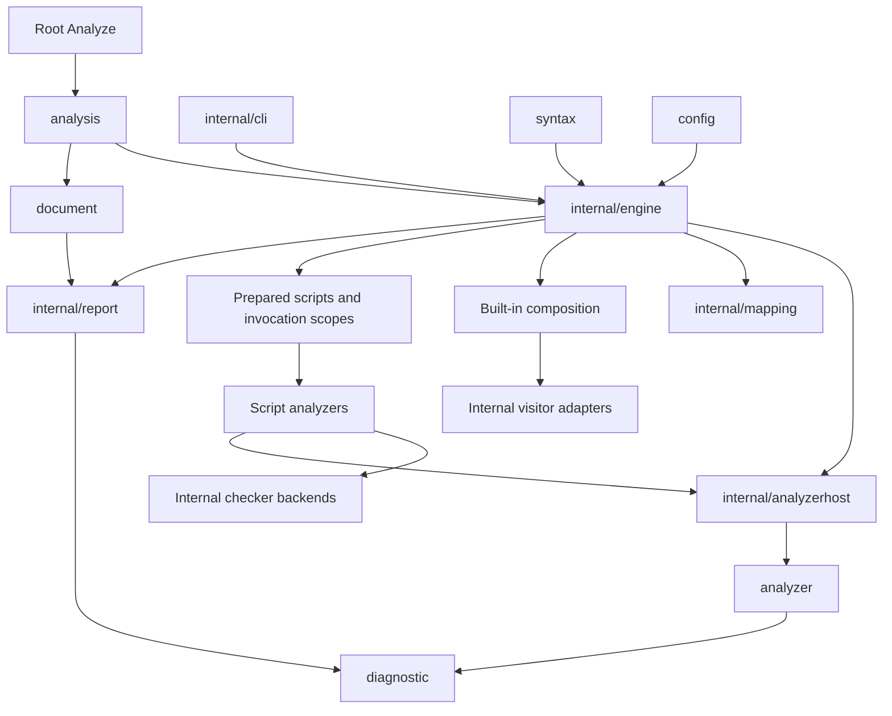

# Analysis contracts and library boundaries

Status: implemented, with the internal visitor migration boundary described below.

## Context

The old root package exposed the same objects used to run the CLI: mutable visitor rules, error collectors,
configuration setters, process scheduling and caches. Traversal failure could skip the post-visit hook that drained
external checkers. The host consequently needed concrete ShellCheck and Ruff type checks to finish work. Composite
analysis repeated tool-specific construction and context handling.

Moving those objects into directories does not provide an independent analyzer contract. The library needs explicit
inputs and returned results, while the host must own completion even when traversal fails.

## Decision

Keep one module and separate the public packages by responsibility. Root contains the convenience entry point and
generation directives. The analysis implementation, legacy rules and their tests live in `internal/engine`.
`internal/analyzerhost` owns generic execution and resource scopes. `internal/report` owns document models and their codecs; the public `document` package exposes those models without
importing the engine. Existing focused internal packages retain ownership
of mapping resolution, external checker logic, filesystem reads, configuration trees and suppressions.

New analyzers declare required facts and return diagnostics and errors. They have no AST-visit, configuration mutation
or debug-output methods. The host isolates their input slices, validates fact availability, preserves partial results,
and joins execution before returning. Cancellation is cooperative: implementations must honor their context and finish
child work before returning. Registration order determines combination order, followed by normal source ordering.

A document resource scope registers join operations before execution. It drains every resource after traversal and on
early exit, including injected checkers with their own runners. Concurrent completion calls share one result. Resource
ownership is a separate capability from internal traversal rules. Configuration and debug configuration are separate
capabilities too. The document runner does not identify external tool types to wait for them.

Tool selection and initialization policy belong to built-in composition. Ruff, ShellCheck and deprecated-command checks
consume a prepared script batch and return findings and an error. They do not implement visitors. Each invocation records
its shell selection, configuration, source location and suppression origin. ShellCheck additionally requires effective
execution facts: runner defaults, working directories and checkout/action placement. The collector resolves these facts
only when a selected analyzer requires them. Composite scripts receive their own scope and do not inherit workflow shell
or working-directory defaults.

Built-in script analyzers and public analyzers use the same bounded task executor. It preserves registration order and
partial results and waits for every started task. Each external checker owns and joins its callbacks before returning,
including on cancellation or an error. Callbacks write to separate per-script result slots. Rendering retains rule
metadata instead of retaining executable rule objects. The Playground supplies an embedded ShellCheck runner directly.

Composite analysis still requests capabilities for the remaining visitor adapters: checkout state, metadata validation,
child construction and result joining. Configuration for action inputs is projected to applicable rules before overrides
are merged. Workflow-only option constraints cannot invalidate an action's script or suppression settings. Tool planning
and analysis use the same selected-input scope.

Mapping resolution provides one key contract: canonical value, source provenance, evaluated-data provenance and
known/unknown/invalid state. Consumers must retain uncertainty instead of turning runtime names into closed object
shapes, and must not parse expression-looking text returned as data a second time.

## Tradeoffs and limits

- One module makes these packages share a release and permits internal implementation imports. Separate modules would
  require independent compatibility and release contracts that this change does not establish.
- Configuration and syntax models still use selected aliases into the engine. Diagnostics, analyzer contracts and
  document models own their types independently. Moving model ownership further requires separating parser source-mapping state from syntax data.
- Existing built-in checks still use a shared AST traversal internally. This change removes that traversal from the public
  extension contract and separates its resource/configuration/debug capabilities; it does not claim that every built-in
  rule has been rewritten as a fact consumer.
- Script facts describe declarations. They do not promise complete effective runtime environments or resolved default
  shells. Mapping completeness describes static knowledge, not runtime coverage.
- Existing CLI behavior remains covered by its own tests. Removed library symbols have explicit migration guidance;
  there is no root compatibility layer re-exporting the old implementation.

## Verification

External-package tests exercise the public root entry point, config and syntax packages, file analysis, custom analyzer
partial results and composite-action scripts. Host tests cover input isolation, unavailable facts, cancellation and
joining all resources once. Engine regressions cover traversal failure, cancellation with retained findings, independent script scopes and fallback
when either ShellCheck range endpoint cannot be mapped. Import-boundary tests check that public analyzer, diagnostic and
document contracts have no transitive dependency on the engine, CLI or process execution. Existing semantic, CLI,
generator and conformance suites remain applicable.
