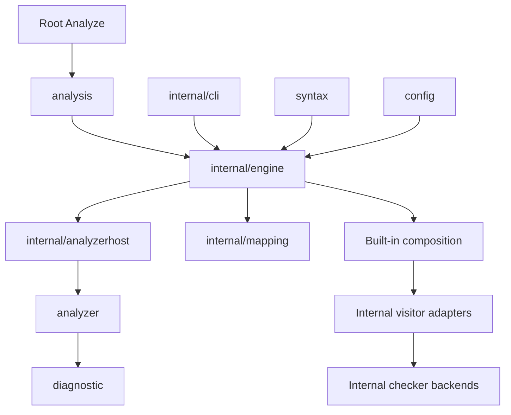

# Analysis contracts and library boundaries

Status: implemented, with the internal visitor migration boundary described below.

## Context

The old root package exposed the same objects used to run the CLI: mutable visitor rules, error collectors,
configuration setters, process scheduling and caches. Traversal failure could skip the post-visit hook that drained
external checkers. The host consequently needed concrete ShellCheck and Ruff type checks to finish work. Composite
analysis repeated tool-specific construction and context handling.

Moving those objects into directories does not provide an independent analyzer contract. The library needs explicit
inputs and returned results, while the host must own completion even when traversal fails.

## Decision

Keep one module and separate the public packages by responsibility. Root contains the convenience entry point and
generation directives. The analysis implementation, legacy rules and their tests live in `internal/engine`.
`internal/analyzerhost` owns generic execution and resource scopes. Existing focused internal packages retain ownership
of mapping resolution, external checker logic, filesystem reads, configuration trees and suppressions.

New analyzers declare required facts and return diagnostics and errors. They have no AST-visit, configuration mutation
or debug-output methods. The host isolates their input slices, validates fact availability, preserves partial results,
and joins execution before returning. Cancellation is cooperative: implementations must honor their context and finish
child work before returning. Registration order determines combination order, followed by normal source ordering.

A document resource scope registers join operations before execution. It drains every resource after traversal and on
early exit, including injected checkers with their own runners. Concurrent completion calls share one result. Resource
ownership is a separate capability from internal traversal rules. Configuration and debug configuration are separate
capabilities too. The document runner does not identify external tool types to wait for them.

Tool selection and initialization policy belong to built-in composition and adapters. Composite analysis requests
capabilities for child construction, checkout state, metadata validation and result joining. Each adapter owns its
configuration and state adaptation. Suppression-origin snapshots use a capability rather than concrete tool switches.

Mapping resolution provides one key contract: canonical value, source provenance, evaluated-data provenance and
known/unknown/invalid state. Consumers must retain uncertainty instead of turning runtime names into closed object
shapes, and must not parse expression-looking text returned as data a second time.

## Tradeoffs and limits

- One module makes these packages share a release and permits internal implementation imports. Separate modules would
  require independent compatibility and release contracts that this change does not establish.
- Configuration, syntax and outline models use selected public aliases. Diagnostics and analyzer contracts own their
  types independently. Moving model ownership further requires separating parser source-mapping state from syntax data.
- Existing built-in checks still use a shared AST traversal internally. This change removes that traversal from the public
  extension contract and separates its resource/configuration/debug capabilities; it does not claim that every built-in
  rule has been rewritten as a fact consumer.
- Script facts describe declarations. They do not promise complete effective runtime environments or resolved default
  shells. Mapping completeness describes static knowledge, not runtime coverage.
- Existing CLI behavior remains covered by its own tests. Removed library symbols have explicit migration guidance;
  there is no root compatibility layer re-exporting the old implementation.

## Verification

External-package tests exercise the public root entry point, config and syntax packages, file analysis, custom analyzer
partial results and composite-action scripts. Host tests cover input isolation, unavailable facts, cancellation and
joining all resources once. An engine regression forces traversal failure after an injected checker has scheduled work
and verifies that completion waits for it. Existing semantic, CLI, generator and conformance suites remain applicable.
