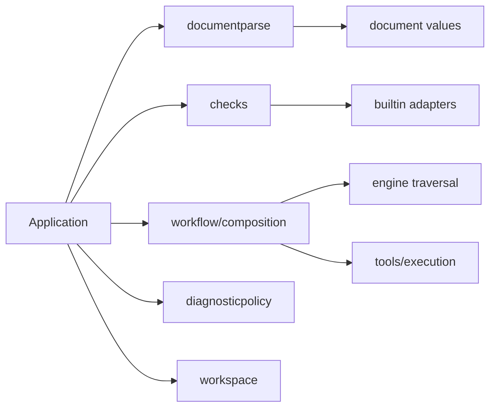

# Analysis ownership

## Status

Accepted.

## Context

A single document check previously selected configuration and rules, dispatched
workflow/action decoding, traversed composites, constructed tools, ran scripts,
joined processes and applied diagnostic policy. Separate files left all of those
responsibilities inside the engine's dependency graph.

## Decision

Application owns composition and invocation resources. The engine receives
synchronous passes and traversal hooks; it does not construct registrations,
resolve configuration, dispatch document languages or manage execution.

| Owner                           | Contract                                                                                                            |
| ------------------------------- | ------------------------------------------------------------------------------------------------------------------- |
| `document`                      | Workflow/action outlines, references and serialization, without configuration dependencies.                         |
| `internal/documentparse`        | Separate workflow and action decoders, syntax findings, outlines and source indexes.                                |
| `internal/checks`               | Builtin selection, configured analyzer registrations, pass configuration and synchronous provenance capture.        |
| `internal/application`          | Input dispatch, resolved document configuration, registration validation, tool construction and resource ownership. |
| `internal/workspace`            | Repository discovery and immutable Git index snapshots shared within a session.                                     |
| `internal/engine`               | Ordered workflow traversal over supplied passes, with hooks for caller-owned expansion.                             |
| `internal/workflow/composition` | Nested invocation discovery, execution facts, script completion and collection into one result.                     |
| `internal/tools/execution`      | Prepared script batches, fact/tool adapters and bounded execution.                                                  |
| `internal/diagnosticpolicy`     | Reference inference, suppression/severity/filter policy, diagnostic completion and cross-document deduplication.    |

Workflow and standalone-action analysis have distinct entrypoints. They share
invocation machinery and value projections without routing action metadata through
workflow traversal.

Composite analysis returns findings, script facts, loaded sources and resolved
composite configurations together. It executes prepared script services and joins
resources before reading rule collectors, including after traversal failure.
Adapter-construction failures are joined by the application before returning.
Cleanup failures accompany partial findings and are reported once.

Script producers snapshot ownership before execution, independently of suppression
selectors. Reference inference consumes explicit owners and source indexes; it does
not reconstruct owners from ignore state.

## Consequences and alternatives

These contracts introduce explicit context/result parameters between stages.
That cost makes resource lifetime and source provenance visible and testable.
Builtin adapters still use visitor state and explicit composite capabilities;
rewriting their semantic implementations is a separate concern.

Moving files without replacing `engine.Run` as the composition root was rejected:
it would preserve the dependency graph and lifetime ambiguity. Creating separate
workflow/action runtimes was also unnecessary; their distinct entrypoints can share
the invocation lifecycle without sharing document dispatch.

## Verification

Transitive import tests keep configuration, registries, tools, policy and workspace
out of the engine, and keep parsing independent of those services. Lifecycle tests
cover execution after traversal failure, joining before collection, cleanup error
identity and fresh versus shared repository snapshots. Application and integration
suites cover partial results, cancellation, action/workflow selection, suppression
ownership, source mappings and serialized report compatibility.
