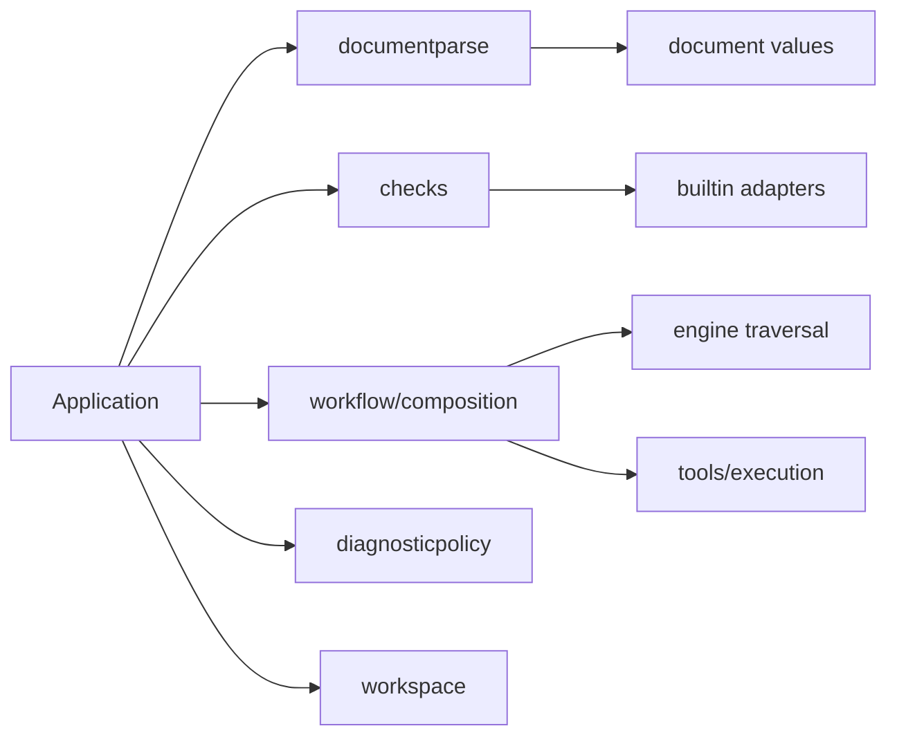

# Analysis ownership

## Status

Accepted.

## Context

A single document check previously selected configuration and rules, dispatched
workflow/action decoding, traversed composites, constructed tools, ran scripts,
joined processes and applied diagnostic policy. Separate files left all of those
responsibilities inside the engine's dependency graph.

## Decision

Application owns composition and invocation resources. The engine receives
synchronous passes and traversal hooks; it does not construct registrations,
resolve configuration, dispatch document languages or manage execution.

| Owner                           | Contract                                                                                                            |
| ------------------------------- | ------------------------------------------------------------------------------------------------------------------- |
| `document`                      | Workflow/action outlines, references and serialization, without configuration dependencies.                         |
| `internal/documentparse`        | Separate workflow and action decoders, syntax findings, outlines and source indexes.                                |
| `internal/checks`               | Builtin selection, configured analyzer registrations, pass configuration and synchronous provenance capture.        |
| `internal/application`          | Input dispatch, resolved document configuration, registration validation, tool construction and resource ownership. |
| `internal/workspace`            | Repository discovery and immutable Git index snapshots shared within a session.                                     |
| `internal/engine`               | Ordered workflow traversal over supplied passes, with hooks for caller-owned expansion.                             |
| `internal/workflow/composition` | Nested invocation discovery, execution facts, script completion and collection into one result.                     |
| `internal/tools/execution`      | Prepared script batches, fact/tool adapters and bounded execution.                                                  |
| `internal/diagnosticpolicy`     | Reference inference, suppression/severity/filter policy, diagnostic completion and cross-document deduplication.    |

Workflow and standalone-action analysis have distinct entrypoints. They share
invocation machinery and value projections without routing action metadata through
workflow traversal.

Workflow parsing indexes scalar context and comments and checks flow-mapping-null
syntax on the physical YAML graph, then builds a detached parser projection.
Alias targets share declarations within that projection; alias-use provenance
points to the original source nodes. AST parsing and expression-source collection
consume the projection. Action metadata consumes its original graph through Cursor.
Reusable-call metadata validates and decodes its original graph through Cursor;
its recovered workflow facts come from a separate `workflow.Parse` projection.

Before semantic construction, the codec admits expansion on the physical graph
using its shared session counters and resource policy. Workflow alias inspection
selects the permitted source slots; rejected recursive uses remain recoverable.
Workflow, action and reusable-call entrypoints enforce this boundary. An action
rejected by admission retains its outline but cannot construct semantic provenance,
including after a schema error. This resource policy does not define GitHub's YAML
dialect.

Source snapshots retain recovered declarations after schema failures. Analysis
eligibility belongs to `Document.CanAnalyze` and local metadata status; composition
checks those before collecting executable scripts.

Composite analysis returns findings, script facts, loaded sources and resolved
composite configurations together. It executes prepared script services and joins
resources before reading rule collectors, including after traversal failure.
Adapter-construction failures are joined by the application before returning.
Cleanup failures accompany partial findings and are reported once.

Each composite invocation has its own traversal frame: source snapshot,
configuration, invocation context, script scope and local-action resolver.
The session owns graph construction and accumulated results. Resolver forks
share consulted-source storage; joining a child transfers checkout and persistent
environment effects according to its condition, background and failure policy.
Nested traversal does not replace the caller's frame while callbacks run.
Checkout chains use value handles over private storage; returned details are
copies. Prepared batches share these immutable handles without cloning the chain.

Declaration lookup returns immutable views. Workflow and action traversal still
expose AST cursors to rule callbacks; migrating those callbacks and removing
`Workflow()`/`ActionSteps()` is separate unfinished work.

Configuration report values live in `config/report`. Result storage and rendering
depend on that leaf contract, independently of configuration loading and resolution.
Metadata parse findings carry their captured source revision when created; source
admission never reconstructs that provenance from a display path.

Script producers snapshot ownership before execution, independently of suppression
selectors. Reference inference consumes explicit owners and source indexes; it does
not reconstruct owners from ignore state.

## Consequences and alternatives

These contracts introduce explicit context/result parameters between stages.
That cost makes resource lifetime and source provenance visible and testable.
Builtin adapters still use visitor state and explicit composite capabilities;
rewriting their semantic implementations is a separate concern.

Moving files without replacing `engine.Run` as the composition root was rejected:
it would preserve the dependency graph and lifetime ambiguity. Creating separate
workflow/action runtimes was also unnecessary; their distinct entrypoints can share
the invocation lifecycle without sharing document dispatch.

## Verification

Transitive import tests keep configuration, registries, tools, policy and workspace
out of the engine, and keep parsing independent of those services. Lifecycle tests
cover execution after traversal failure, joining before collection, cleanup error
identity and fresh versus shared repository snapshots. Application and integration
suites cover partial results, cancellation, action/workflow selection, suppression
ownership, source mappings and serialized report compatibility.
