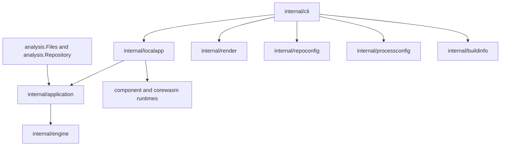

# Application and CLI boundary

## Decision

The CLI translates command syntax into an application request. The application
owns analysis execution and closes engines it loads before returning a result.
The CLI owns terminal behavior, exit status, summaries and report publication.

`localapp` supplies the local WASM loaders and owns component-plugin lifetime.
`application` accepts injected analyzer registrations and backend loaders. Neither
the engine nor the public analysis API acquires a dependency on a WASM runtime.
Explicitly supplied backends remain caller-owned; engines created by the loader
are session-owned.

## Responsibilities

- `application.Check` selects explicit files, stdin or repository discovery,
  including the empty-repository convention used by pre-commit. It returns
  source-aware findings, configuration provenance and consumed input paths.
- The result contains the rule descriptions and source text needed for rendering.
  Renderers do not inspect engine sessions or traversal state.
- Cleanup runs with cancellation removed from its context. Cleanup errors are
  joined with analysis failures, preserving partial results. Report publication
  occurs only after analysis and cleanup succeed.
- `cli/check.go` coordinates the request and selects the exit status.
  `check_render.go` handles terminal formatting; `report_destination.go` owns
  confirmation, temporary files and atomic publication.
- Configuration creation and the embedded default template belong to
  `repoconfig`. Static rule metadata also comes from its existing catalogue.
- Native command options and executable resolution belong to `processconfig`.
- Release identity belongs to `buildinfo`. Build recipes stamp
  `internal/buildinfo.ReleaseVersion` and `internal/buildinfo.InstallOrigin`.

## Alternatives and trade-offs

Importing the public `analysis` API directly from the CLI would avoid a direct
engine import, but its result intentionally omits the source buffers and rule
metadata required by text and template output. Extending that public contract
with terminal concerns would move the coupling into the library API.

The application result instead uses the existing internal rendering data contract.
This retains source fidelity without exposing the legacy engine result publicly.
It does mean that file-analysis library calls currently prepare rendering data
that the public result view discards.

The legacy engine facade remains for internal callers and tests. The engine still
contains repository/configuration discovery, rule traversal and tool scheduling;
this change does not claim those internals are fully separated. The new boundary
allows that work to proceed without changing CLI command handlers.

## Enforcement

Architecture tests reject direct CLI imports of engine and plugin-runtime
implementations, application dependencies on the CLI or command framework, and
concrete WASM runtime dependencies in the engine, application and public analysis
API. Lifecycle tests cover successful checks, analysis failures, cleanup failures,
combined failures and cancellation. Existing CLI tests cover report publication,
format equivalence, pre-commit discovery and terminal behavior.
