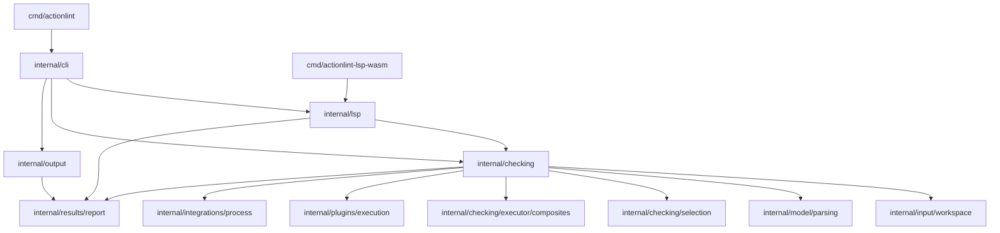

# CLI, editor and checking responsibilities

The native CLI and the language server submit requests to `internal/checking`.
The browser executable starts the same language server through a browser transport.
Command parsing, editor messages and output destinations belong to those callers.

## Checking requests

`checking.Check` accepts an `input.Request` and checking options. The request
selects files, a repository, stdin or prepared sources. Workspace selection reads
configuration and captures source text. `checking.Analyze` submits already prepared
sources without discovering configuration or reading their paths again.

`checking.CheckWithPlugins` loads selected plugins, supplies their registrations
to `Check`, and closes those plugins afterward. File-based plugin arguments are
converted to selected sources by `CheckWithPluginPaths`.

Rules receive decoded models and the data their declarations request. The
checking session collects that data and coordinates nested invocations.
Renderers and LSP diagnostic converters do not start another analysis.

## Resource ownership

The checking session waits for its process pool before closing engines loaded
for the session. Cleanup uses a context that is not cancelled when the request
is cancelled. Cleanup errors are joined with the checking error, so a caller can
receive findings together with an explanation of incomplete work.

A caller that supplies a backend directly owns that backend. A loader-created
engine is closed by the session that loaded it. Plugin loading has its own
matching close operation around the check.

## Results and delivery

`internal/results/report.Analysis` carries findings, captured sources, document
outlines, configuration reports and rule descriptions. It contains no live rules,
parser nodes or process handles. The CLI uses the report to render output, and
the language server uses it to produce editor diagnostics.

The CLI selects output formats and opens destinations. Output renderers write to
supplied writers. The CLI owns process status and stderr. The LSP owns protocol
responses, document versions and edit delivery.

`internal/cli/check.go` executes the check command. `check_render.go` constructs
renderers; `report_destination.go` manages output files and their publication.
Build metadata comes from `internal/integrations/buildinfo`.
