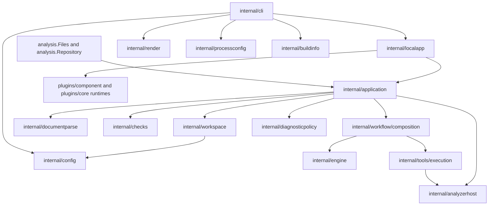

# Application and CLI boundary

## Decision

The CLI translates command syntax into an application request. The application
owns analysis execution and closes engines it loads before returning a result.
The CLI owns terminal behavior, exit status, summaries and report publication.

`localapp` supplies the local WASM loaders and owns component-plugin lifetime.
`application` accepts injected analyzer registrations and backend loaders. Neither
the engine nor the public analysis API acquires a dependency on a WASM runtime.
Callers manage explicitly supplied backends; the session closes engines created
by its loader.

## Responsibilities

- `application.Check` coordinates input preparation, analysis and backend cleanup,
  including the empty-repository convention used by pre-commit. It drains the shared
  process pool before closing loaded backends. It assembles the document context,
  configured check registry, tool services and diagnostic policy.
- `workspace` owns repository discovery, configuration loading and overlays,
  file selection, source reads and configuration provenance. Its `Selection`
  carries resolved sources and all consumed paths, including excluded discovery
  candidates. It has no parser or analyzer dependency.
- `analyzerhost` owns concurrent analyzer scheduling and the pool of loaded
  script backends. It has no traversal or repository-configuration dependency.
- The result contains the rule descriptions and source text needed for rendering.
  Renderers do not inspect engine sessions or traversal state.
- Cleanup runs with cancellation removed from its context. Cleanup errors are
  joined with analysis failures, preserving partial results. Report publication
  occurs only after analysis and cleanup succeed.
- `cli/check.go` coordinates the request and selects the exit status.
  `check_render.go` handles terminal formatting; `report_destination.go` owns
  confirmation, temporary files and atomic publication.
- Configuration creation and the embedded default template belong to
  `internal/config`. Static rule metadata also comes from its existing catalogue.
- Native command options and executable resolution belong to `processconfig`.
- Release identity belongs to `buildinfo`. Build recipes stamp
  `internal/buildinfo.ReleaseVersion` and `internal/buildinfo.InstallOrigin`.

## Alternatives and trade-offs

Importing the public `analysis` API directly from the CLI would avoid a direct
engine import, but its result intentionally omits the source buffers and rule
metadata required by text and template output. Extending that public contract
with terminal concerns would move the coupling into the library API.

The application returns `report.Analysis`, a value model of diagnostics, source
snapshots, document outlines, configuration provenance and rule descriptors.
`render.Prepare` derives presentation values at the output boundary. The public
library selects its public result view without constructing a renderer.

Legacy linter/session and rendering compatibility adapters are test-only. Production
callers use the application boundary, including the GitHub Action, Playground and
documentation checker. Synthetic repository identities use `workspace.Identity`.

`documentparse` decodes workflows and action manifests through separate entrypoints.
`checks` constructs the configured semantic passes. `workflow/composition` receives
those passes and a script service, owns nested invocation analysis, and joins work
before returning findings, script facts and source provenance. The engine only
traverses workflow syntax. `diagnosticpolicy` enriches references and applies
source-specific suppressions, severity, path filters and deduplication after all
analyzers finish. See [Analysis ownership](analysis-ownership.md) for the decision
and dependency constraints.

Five declaration checks use a shared visitor adapter over stateless workflow
projections. Expression, composite and policy adapters use traversal state.

## Enforcement

Architecture tests reject direct CLI imports of engine and plugin-runtime
implementations, application dependencies on the CLI or command framework, and
concrete WASM runtime dependencies in the engine, application and public analysis
API. Additional dependency checks keep input preparation independent of analysis
and scheduling independent of traversal/configuration. Tests exercise preparation
of malformed source without parsing, per-batch provenance, and script execution
that follows traversal and completes before findings are collected. Lifecycle tests cover successful checks, analysis failures, cleanup failures,
combined failures and cancellation. Existing CLI tests cover report publication,
format equivalence, pre-commit discovery and terminal behavior.
