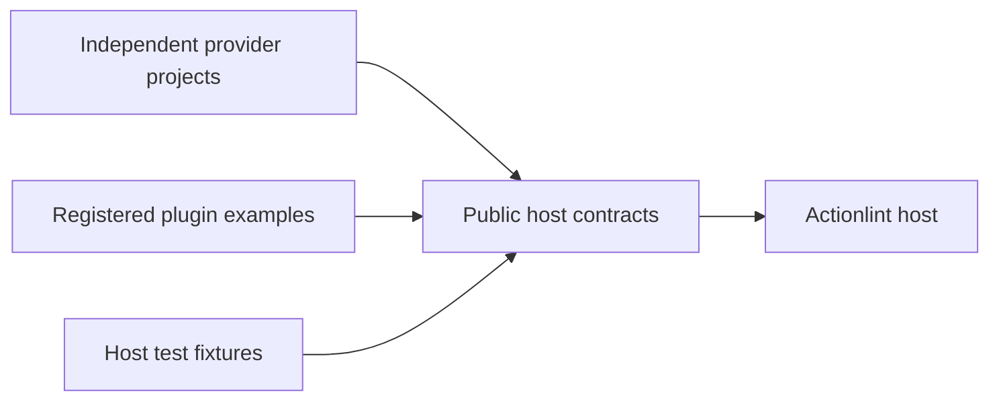

# Plugin and tooling ownership

## Decision

Production providers own their dependencies, builds and releases. The Commitish
resolver lives in the separate `actionlint-plugin-commitish` project, alongside
`actionlint-plugin-ruff` and `actionlint-plugin-shellcheck`. Actionlint owns the
host interfaces and their compatibility tests. Commitish uses the native JSON
resolver protocol; the script engines and component analyzers use their respective
WASM interfaces. Repository separation does not change those protocols.

The root Cargo package registers the Rust plugin under `[[example]]`. Its workspace
contains only the host-owned examples and the Rust fixtures under `testdata/plugins`.
Dependencies, the lockfile, toolchain and WASM profile are shared within that scope.
The C and TinyGo examples live alongside the Rust example under `examples/plugins`
and have explicit Make targets. Native checks and the two WASM targets are built
separately. Built fixture binaries stay beside their Go host tests.

Release, CI, toolchain, matcher, action verification and schema-generation programs
live under `tools/`, with their tests. The Docker action wrapper and container tests
belong to `distribution/docker`. Comment Cop's helper belongs to its GitHub action.
`internal/githubaction` contains the Go action runtime.

## Consequences

Host builds do not compile or resolve the production Commitish provider. Independent
providers can release without changing the host. Cross-project compatibility must
be checked through their public interfaces rather than a shared Cargo workspace.

Examples build from the repository using Cargo and their own language toolchains.
There is no custom manifest exporter or second implementation of Cargo inheritance.
An external Rust analyzer owns its manifest and consumes `actionlint-extension-api`.
The SDK exposes guest bindings and an export macro; its optional native `package`
feature handles discovery metadata and distribution files. Plugins supply their
own descriptor, Cargo identity, engine, capabilities and license. Non-Rust guests
can consume the canonical public WIT contracts directly.

The SDK owns the public contracts in [`crates/actionlint-extension-api/wit`](../../crates/actionlint-extension-api/wit).
Host generation, examples and fixtures read these same files. Cargo includes
them in the published package.
The `source-annotations` feature opts into an additional host import without
changing the original analyzer interface or its contract digest.

Host fixtures and examples share the workspace's dependency pins.
This avoids independent fixture lockfiles without coupling production providers to
host test dependencies. The WASM profile optimizes guest artifacts without forcing
those settings on native checks or external provider releases.
