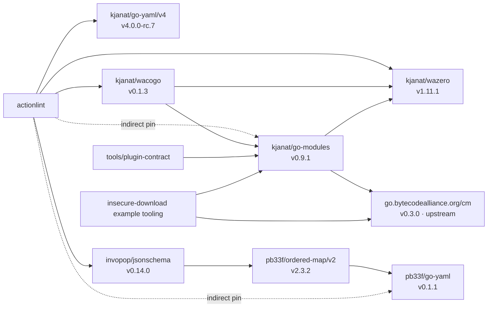

# Go dependency forks

This is the maintenance inventory for actionlint's Go forks, their recursive
dependencies, and the modules that consume them. Versions were checked against
the module graphs on **2026-11-02**. Update this inventory when changing a pin.

Most fork changes have accompanying upstream PRs. The intent is to switch consumers
back to upstream modules as the required changes merge and become available in
versions we can pin. Track the upstream PRs and remaining blockers below.

## Selected graph

Versions label the selected modules. Individual dependency requirements can name
lower versions; Go selects one version of each module path for a build.



The `kjanat/*` labels above are `github.com/kjanat/*` module paths. Sources of
truth are the root [go.mod](../go.mod), [plugin-contract module](../tools/plugin-contract/go.mod),
and [insecure-download module](../examples/plugins/insecure-download/go.mod).
The [analyzers module](../analyzers/go.mod) currently has no fork requirements.

## Maintained forks

| Fork and selected tag                                                                            | Upstream repository                                                             | Consumers and retained changes                                                                                                                                                                                                                                                                                                                                                                                                                                                                                                                                                                    |
| ------------------------------------------------------------------------------------------------ | ------------------------------------------------------------------------------- | ------------------------------------------------------------------------------------------------------------------------------------------------------------------------------------------------------------------------------------------------------------------------------------------------------------------------------------------------------------------------------------------------------------------------------------------------------------------------------------------------------------------------------------------------------------------------------------------------- |
| [`github.com/kjanat/go-yaml/v4@v4.0.0-rc.7`](https://github.com/kjanat/go-yaml/tree/v4.0.0-rc.7) | [`yaml/go-yaml`](https://github.com/yaml/go-yaml)                               | Workflow/action YAML and configuration decoding. Preserves original occurrence and alias context through `WithOccurrenceFunc` and `LoadWithAliasContext`; publishes under the fork module path. See the [occurrence change](https://github.com/kjanat/go-yaml/commit/b29e171e3237e4a3b4106c67cdaaacdf336a66fa) and actionlint's [codec](../internal/yaml/codec/cursor.go).                                                                                                                                                                                                                        |
| [`github.com/kjanat/wazero@v1.11.1`](https://github.com/kjanat/wazero/tree/v1.11.1)              | [`wazero/wazero`](https://github.com/wazero/wazero)                             | Core Wasm engines, component execution through wacogo, and WIT tooling through go-modules. Retains table allocation/growth limits and Windows link handling, with fork import paths. See the [retained runtime patch](https://github.com/kjanat/wazero/commit/2dce1ead940872fa80c0ede068ca762583ba4043) and [TableLimiter contract](https://github.com/kjanat/wazero/blob/v1.11.1/experimental/table.go).                                                                                                                                                                                         |
| [`github.com/kjanat/go-modules@v0.9.1`](https://github.com/kjanat/go-modules/tree/v0.9.1)        | [`bytecodealliance/go-modules`](https://github.com/bytecodealliance/go-modules) | WIT loading/binding generation, consumed by wacogo, plugin-contract, and the TinyGo example's build tool. Retains Windows WIT loader/generator path and runtime cleanup fixes, and routes runtime use through our wazero fork. See the [pinned README](https://github.com/kjanat/go-modules/blob/v0.9.1/README.md) and [upstream patch #429](https://github.com/bytecodealliance/go-modules/pull/429).                                                                                                                                                                                            |
| [`github.com/kjanat/wacogo@v0.1.3`](https://github.com/kjanat/wacogo/tree/v0.1.3)                | [`partite-ai/wacogo`](https://github.com/partite-ai/wacogo)                     | Component-model execution, generated host bindings, and core-module inspection. Retains ownership/close handling, lifting budgets, table accounting and generated-decoder changes; also exports [named primitive aliases](https://github.com/kjanat/wacogo/commit/c19a437b69411e165a6cefc56ad12acba1921581) and fixes [processing imports after an eq-bound type import](https://github.com/kjanat/wacogo/commit/8a2a9ec1f52a83f79818b911b95925a92e15f86b). See the [pinned README](https://github.com/kjanat/wacogo/blob/v0.1.3/README.md) and [runtime contract](design/analysis-contracts.md). |

The root module directly requires go-yaml, wacogo and wazero; go-modules is an
indirect requirement. `tools/plugin-contract` directly requires go-modules and
generates code that uses wacogo's parser types. The insecure-download example
selects `github.com/kjanat/go-modules/cmd/wit-bindgen-go` as a Go tool. Its
`go.bytecodealliance.org/cm` dependency remains the separately versioned upstream
module, including when the WIT tool comes from our fork.

## Additional YAML fork

[`github.com/pb33f/go-yaml@v0.1.1`](https://github.com/pb33f/go-yaml/tree/v0.1.1)
is another fork of [`yaml/go-yaml`](https://github.com/yaml/go-yaml), maintained by
pb33f. Schema tooling reaches it through invopop/jsonschema and pb33f/ordered-map;
the root module pins the selected version indirectly. Actionlint's own YAML codec
uses `github.com/kjanat/go-yaml/v4`.

## Updating forks

Check the upstream PRs first. When an upstream version contains the required
changes, switch the affected imports, tooling and dependency pins back to that
module. Update dependency providers before their consumers:

1. **wazero**: integrate upstream changes with the retained runtime patches and
   fork module/import paths, verify the fork, then publish its signed version tag.
2. **go-modules**: update its wazero requirement, verify WIT loading/generation
   and cleanup, then publish its signed version tag.
3. **wacogo**: update both runtime requirements, verify component lifetimes,
   budgets and generated bindings, then publish its signed version tag.
4. **actionlint**: update the root module and both affected tool/example modules.
   Use `go get` for version changes and `go mod tidy` in each affected module to
   resolve indirect requirements and checksums. Refresh generated contracts and
   the Nix vendor hash when their inputs change; run the relevant runtime,
   code-generation and integration checks.

The go-yaml fork can be updated independently, followed by actionlint's YAML,
alias/source-mapping and configuration checks. Recheck this graph after tidying.
Tag the actual work commit with a GPG-signed, annotated `v`-prefixed tag.

## Returning to upstream

PR status checked **2026-11-02**. Our forks use `master`; the return criteria are
the required changes and usable upstream module versions.

| Dependency | Upstream work                                                                                                                                                                                                                                                                                                                                                                                                                                                                  | What must be available before switching back                                                                                                                                    |
| ---------- | ------------------------------------------------------------------------------------------------------------------------------------------------------------------------------------------------------------------------------------------------------------------------------------------------------------------------------------------------------------------------------------------------------------------------------------------------------------------------------ | ------------------------------------------------------------------------------------------------------------------------------------------------------------------------------- |
| wazero     | [#2570: table allocation/growth limiter](https://github.com/wazero/wazero/pull/2570), [#2571: Windows symlink destinations](https://github.com/wazero/wazero/pull/2571): open.                                                                                                                                                                                                                                                                                                 | Both runtime changes, including the limiter API consumed by wacogo and actionlint. Switch those consumers together.                                                             |
| go-modules | [#429: Windows WIT loading and generator paths](https://github.com/bytecodealliance/go-modules/pull/429), [#430: OCI dependencies and aligned allocations](https://github.com/bytecodealliance/go-modules/pull/430): open.                                                                                                                                                                                                                                                     | The WIT loading/generation fixes used by our host and build tools, with the required runtime behavior preserved through the dependency chain.                                   |
| wacogo     | [#12: zero-size realloc](https://github.com/partite-ai/wacogo/pull/12), [#13: owned-resource teardown](https://github.com/partite-ai/wacogo/pull/13), [#17: destructor handling](https://github.com/partite-ai/wacogo/pull/17): merged. [#14: lifting and cleanup](https://github.com/partite-ai/wacogo/pull/14), [#15: table accounting](https://github.com/partite-ai/wacogo/pull/15), [#16: generated decoding limits](https://github.com/partite-ai/wacogo/pull/16): open. | Remaining resource/budget fixes, named primitive alias generation and the eq-bound import fix used by our contracts. A merged subset alone does not cover all retained changes. |
| go-yaml    | The occurrence/alias-context patch is linked in the fork inventory above.                                                                                                                                                                                                                                                                                                                                                                                                      | The occurrence APIs used by the codec, with alias/source-mapping and configuration regression checks passing against the upstream module.                                       |

Verify the selected upstream version contains each required change, migrate
imports and generator tool paths, regenerate bindings, then test the consumers
before removing the corresponding fork pins. Record the replacement version here.

## Refreshing this inventory

Run these from the actionlint checkout:

```sh
go list -m all
go mod graph
go -C tools/plugin-contract mod graph
go -C examples/plugins/insecure-download mod graph
```

Read the selected forks' own `go.mod` files to trace recursive requirements;
root `go.mod` indirect entries alone do not explain who requires each fork.
Update the graph, selected versions, consumers and retained-patch evidence here
together with dependency changes. Other documentation links to this inventory
for current fork versions.
