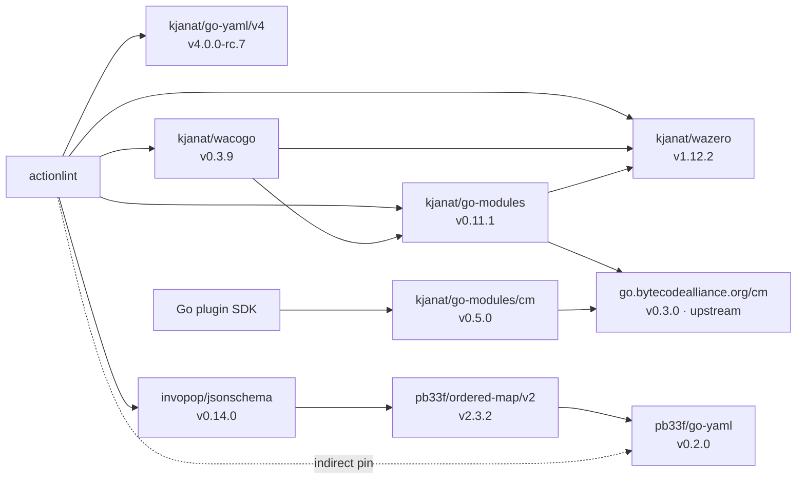

# Go dependency forks

`mise run generate:go-forks` sets each version label to the version that Go selects. The `go.bytecodealliance.org/cm` label must match in the root module, the Go plugin SDK and the `insecure-download` example.

| Fork                                                                        | Upstream                                                                                      | Role                                        |
| --------------------------------------------------------------------------- | --------------------------------------------------------------------------------------------- | ------------------------------------------- |
| [kjanat/go-yaml/v4](https://github.com/kjanat/go-yaml)                      | [yaml/go-yaml](https://github.com/yaml/go-yaml)                                               | YAML decoding                               |
| [kjanat/wacogo](https://github.com/kjanat/wacogo)                           | [partite-ai/wacogo](https://github.com/partite-ai/wacogo)                                     | Component execution                         |
| [kjanat/go-modules](https://github.com/kjanat/go-modules)                   | [bytecodealliance/go-modules](https://github.com/bytecodealliance/go-modules)                 | WIT binding generation                      |
| [kjanat/go-modules/cm](https://github.com/kjanat/go-modules/tree/master/cm) | [bytecodealliance/go-modules/cm](https://github.com/bytecodealliance/go-modules/tree/main/cm) | Component Model types for the Go plugin SDK |
| [kjanat/wazero](https://github.com/kjanat/wazero)                           | [wazero/wazero](https://github.com/wazero/wazero)                                             | Core Wasm execution                         |
