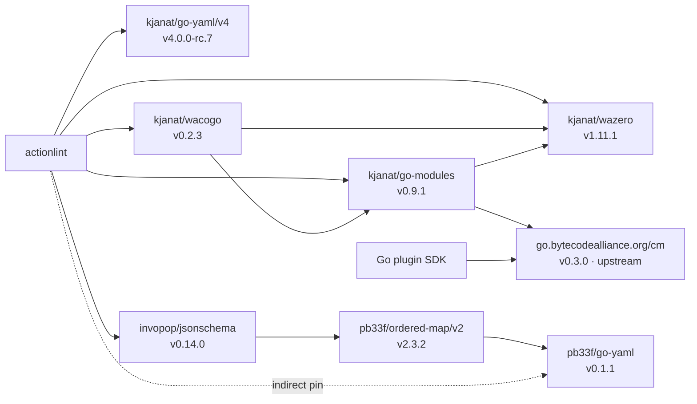

# Go dependency forks

The graph shows which modules depend on which forks. Solid arrows are module
requirements; dotted arrows are indirect requirements in actionlint's root module.
Versions are those selected by the consuming modules.

The `kjanat/*` labels abbreviate `github.com/kjanat/*`. Go selects one version
per module path within each consuming module's graph; a dependency's own minimum
requirement can be lower.

| Fork                                                      | Upstream                                                                      | Role                                                                                      |
| --------------------------------------------------------- | ----------------------------------------------------------------------------- | ----------------------------------------------------------------------------------------- |
| [kjanat/go-yaml/v4](https://github.com/kjanat/go-yaml)    | [yaml/go-yaml](https://github.com/yaml/go-yaml)                               | Workflow, action and configuration YAML decoding.                                         |
| [kjanat/wacogo](https://github.com/kjanat/wacogo)         | [partite-ai/wacogo](https://github.com/partite-ai/wacogo)                     | Component execution and generated host bindings.                                          |
| [kjanat/go-modules](https://github.com/kjanat/go-modules) | [bytecodealliance/go-modules](https://github.com/bytecodealliance/go-modules) | WIT loading and binding generation.                                                       |
| [kjanat/wazero](https://github.com/kjanat/wazero)         | [wazero/wazero](https://github.com/wazero/wazero)                             | Core Wasm execution, directly and through wacogo and WIT tooling.                         |
| [pb33f/go-yaml](https://github.com/pb33f/go-yaml)         | [yaml/go-yaml](https://github.com/yaml/go-yaml)                               | Schema tooling through jsonschema and ordered-map; separate from actionlint's YAML codec. |

The [root module](../go.mod) uses wacogo for components and wazero directly for
core Wasm plugins. Its [plugin-contract generator](../internal/development/generators/plugin-contract)
uses go-modules to read WIT. The root module also declares the `wacogo-witgen`
and `wit-bindgen-go` generation tools. The [Go plugin SDK](../plugins/sdk/go/go.mod)
depends only on the upstream `go.bytecodealliance.org/cm` runtime.

The selected forks' own `go.mod` files define the recursive requirements shown
above.
